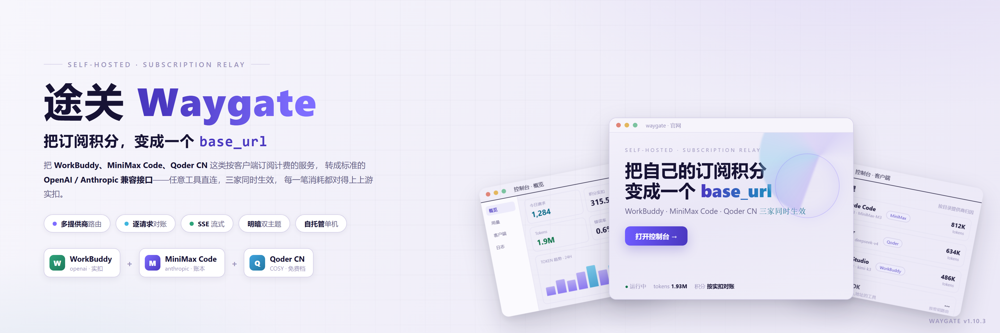
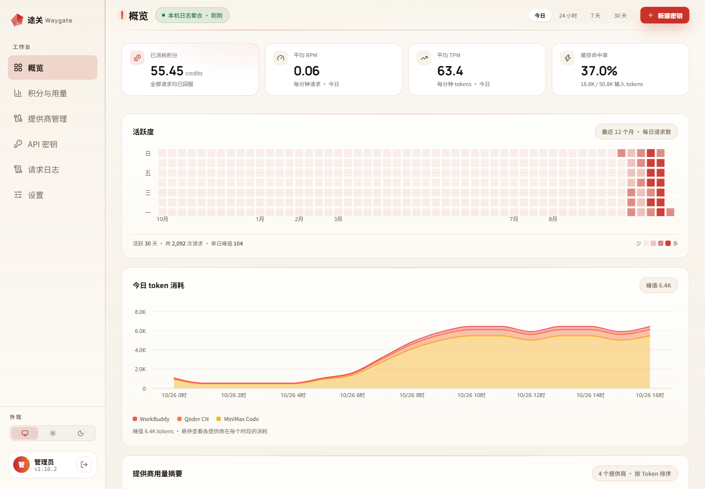
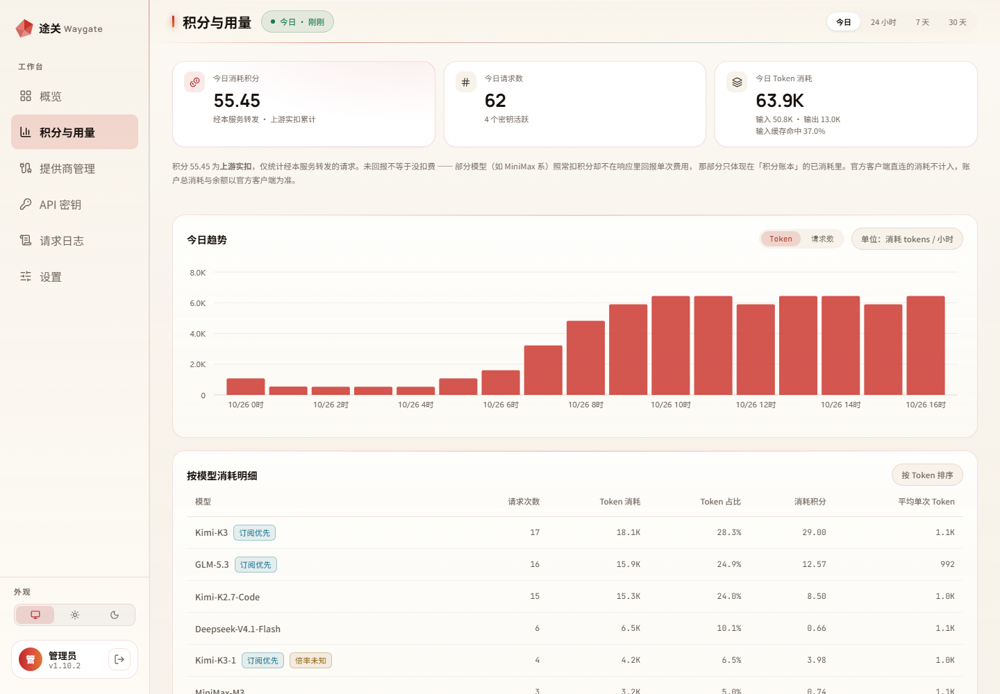
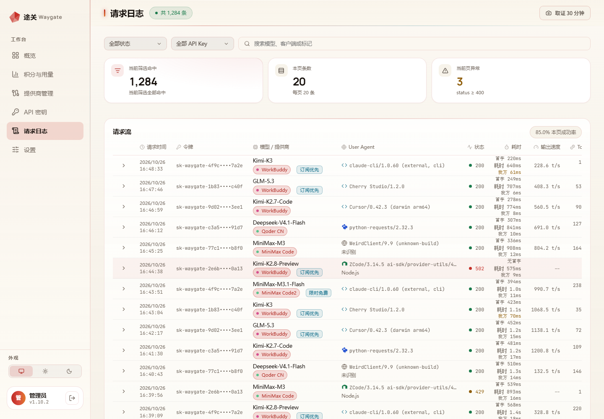
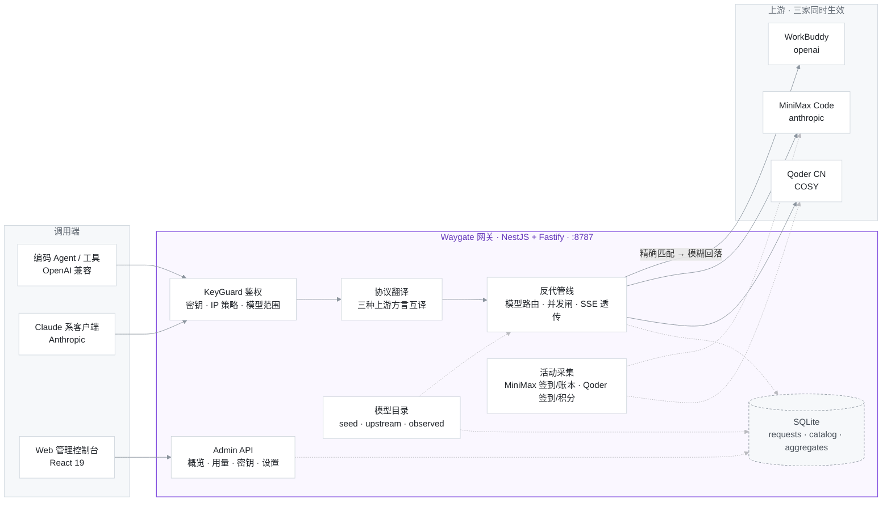
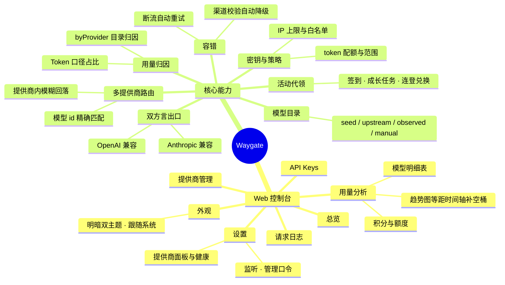

<div align="center">

# 途关 · Waygate

**把订阅积分，变成一个 `base_url`**

[](https://react.dev)
[](https://nestjs.com)
[](https://github.com/WiseLibs/better-sqlite3)
[](https://nodejs.org)
[](https://github.com/zhanghaojie513/waygate-open/releases)
[](./server)



[快速开始](#快速开始) · [功能](#功能) · [接入](#接入) · [多提供商与路由](#多提供商与路由) · [架构](#架构) · [部署](#部署自用单机)

</div>

自托管的「客户端订阅」反向代理：把 **WorkBuddy、MiniMax Code、Qoder CN** 这类**按客户端订阅计费**的服务，转成标准的 **OpenAI / Anthropic 兼容 `base_url`**。

- **任意工具直连** —— Claude Code、Cursor、Cherry Studio、OpenAI SDK……只要能自定义接入地址，就能消费订阅额度
- **三家同时生效** —— 按模型 id 路由到对应提供商，互不干扰（见「多提供商与路由」）
- **控制台对账** —— 逐请求留痕、积分账本、用量趋势，每一分消耗都对得上上游实扣

> [!NOTE]
> 名字：Waygate / 途关 —— 中转关隘。仓库内常见 `relay` 字样同义。

## 控制台一览

| 概览（按提供商归属的用量摘要） | 积分与用量（趋势 / 模型明细） |
| --- | --- |
|  |  |

| 请求日志（逐条留痕，SSE 流也在） |
| --- |
|  |

## 功能

- **双方言出口**：`/v1/chat/completions`（OpenAI 兼容）与 `/v1/messages`（Anthropic 兼容），流式/非流式；三种上游方言自动翻译
- **多提供商**：目录按 `(provider_id, id)` 分区；来源分 `seed / upstream / observed / manual` 四类，observed 由真实流量并入；三家可同时生效
- **导入客户端**（v1.6.11，本版起为**唯一**凭证入口）：控制台选客户端 → 跳各自**官方授权页** → 回来自动落盘凭证。三家的授权机制各不相同（WorkBuddy 业务码判等待 / MiniMax PKCE 设备码 / Qoder PKCE + 404 判等待），服务端按协议分派；私有状态（`device_code` / `code_verifier`）只存服务端，**绝不回传浏览器**。三家凭证都在客户端登录态里、用户拿不到，因此**不提供手填**（WorkBuddy 原用的 `ck_` 密钥已退役，转发也改走 OAuth）——行内「重新导入授权」用于换账号 / 刷新令牌
- **API 密钥**：绑定提供商优先级、权限范围（全部/按族/按模型/按标签）、IP 上限、token 配额、IP 白名单
- **请求日志**：提供商列按「模型 id → 目录归属」解析（`requests` 无 provider_id，绑定名只代表路由偏好）；SSE 流也留痕；**游标（keyset）分页**——翻页期间的新写入不产生重复行；按 `logs.retainDays` 每日自动清理过期日志（启动即补跑停机期间欠的账）
- **积分与用量**：趋势图（Token / 请求数双口径，**等距时间轴**，空桶补零）、按模型 / 按提供商拆分、缓存命中率、缓存 token 计量（Anthropic 口径：prompt = input + cache_creation + cache_read）
- **积分账本**：MiniMax `credit/details` 真实余额（精确到 0.01）；凭证 refresh token 自动续期 + 每日签到（专用账号后即可代签）；WorkBuddy 资源包聚合余额（`get-user-resource` POST 实测口径）
- **Qoder 签到与积分**（v1.6.0，积分口径 v1.6.1 更正）：`campaigns` 签到代领（每日 100 Credits，进**资源包**）+ 积分账本并入概览。走 `openapi.qoder.com.cn`，Bearer 令牌鉴权（**无需 COSY 签名**——那套只用于聊天路径），不顶掉桌面登录。**余额口径**：`v2/me/usage` 给真实余额（`userQuota` 套餐内 + `addOnQuota` 资源包），账本「发放/剩余/已消耗」为真实值；该端点**不提供到期时刻**，故「最近过期」列显示 `—`。另注意 `credits-summary.totalCredits` 是**历史累计消耗**（等于逐日用量之和），与余额不是一回事，单列展示不混算
- **WorkBuddy 领取域**（v1.4.0；v1.6.11 起与转发统一）：签到代领 + 成长任务 + 连登兑换走**用户会话域**（OAuth，`providers/<id>.oauth`，多会话共存不互踢）——正是这条链路让 `ck_` 得以整体退役。诚实边界：任务多为「体验 XX」型，前置条件不满足就如实记 `skipped`，**绝不伪造行为去凑任务**；补登卡/抽奖等资源消耗型操作不自动化
- **容错**：Qoder 零内容断流**自动重试一次**（对客户端无感）；上游 11128 渠道校验自动降级重试
- **控制台**：React 19 单页，明暗双主题（跟随系统/手动，侧栏底部切换；官网与控制台同套主题——棱镜场景浅色下以 `multiply` 显形、深色下以 `screen`），CSS 伪元素 tooltip 体系，同形状骨架屏；页间数据先旧后新（SWR：重进页面即刻渲染上次数据、后台刷新无缝替换，自己的写操作写穿缓存不闪旧态）；「提供商健康」只读总览
- **性能**：路由级代码分割：官网与控制台互不加载对方代码，首屏 gzip <100K；vendor 独立 chunk 享 30d `immutable` 长缓存（发版只重下业务 chunk）；概览 5s TTL 缓存（写操作即清）、SQL 语句按文本缓存复用、凭证文件 stat 失效缓存、last_seen 节流落库——同进程转发 SSE，省下的每次查询/写库都是还给流的事件循环时间；Nginx gzip（level 5）压缩传输

## 快速开始

### 方式一：npm 包（推荐，一条命令）

```bash
npx waygate-open
```

起本地服务并**自动打开浏览器**到控制台（默认 <http://127.0.0.1:8787/console>）。
首次启动的管理口令默认是 **`waygate`** —— 仅当只监听回环（`127.0.0.1`）时套用这个
默认值；对外监听时改为随机生成并打印在启动日志里。登录后建议去「设置 → 管理口令」改掉。

数据默认落在 `~/.waygate/open/`（库与密钥都在那里）。

常用参数（都有等价环境变量）：

```bash
npx waygate-open --port 9000          # 换端口（RELAY_PORT）
npx waygate-open --password 我的口令   # 换初始口令（RELAY_ADMIN_PASSWORD）
npx waygate-open --data-dir ./data    # 换数据目录（RELAY_DATA_DIR）
npx waygate-open --no-open            # 不开浏览器（服务器 / CI）
npx waygate-open --help               # 全部选项
```

> ⚠️ 默认只监听 `127.0.0.1`。要对外提供（别的机器也能连）需显式 `--host 0.0.0.0`，
> 并自担公网暴露后果 —— 本进程持有你的订阅凭证与控制台口令。

### 方式二：从源码跑（改代码 / 开发用）

环境：Node ≥ 22.9（server）/ ≥ 20.19（web）。

```bash
# 后端（默认 127.0.0.1:8787）
cd server && npm i
npm run dev

# 控制台（另开终端）
cd web && npm i
npm run dev               # 真实联调，代理到 127.0.0.1:8787
npm run dev:mock          # 或：纯前端开发，内置 Mock 数据（口令 relay-dev）
```

> 源码形态下**后端也会同源托管 `web/dist`**：先 `cd web && npm run build`，
> 之后只跑后端、直接访问 `http://127.0.0.1:8787/console` 即可（不必再开 vite）。
> 没构建过前端时后端只提供 API，并在日志里提醒。

关键环境变量（完整说明见 `server/.env.example`）：

| 变量 | 作用 |
| --- | --- |
| `RELAY_UPSTREAM_KEY` | 可选：无 OAuth 时代的全局出站凭证（**v1.6.11 起 WorkBuddy 走 OAuth，不再需要**） |
| `RELAY_SECRET` | HMAC：密钥哈希 + 会话令牌签名，丢失等于全部密钥作废 |
| `RELAY_ADMIN_PASSWORD_HASH` | 管理口令 scrypt 哈希（不设则四级回落，首启打印一次性口令） |
| `RELAY_DATA_DIR` / `RELAY_PORT` | 数据目录（默认 `./data`）与端口（默认 8787） |

**Qoder CN 凭证**（若要用第三家）：从本机 Qoder 客户端登录态一键导入，无需手抄令牌：

```bash
cd server && node tools/qoder-import-credential.mjs <provider_id>
# 例：node tools/qoder-import-credential.mjs p_qoder01
```

> [!NOTE]
> Qoder 凭证**不自动刷新**（本服务用导入的令牌；令牌约 30 天过期时重跑本脚本即可）。
> 桌面客户端与它**互不影响**（Qoder 多会话并存，实测 2026-10-16）。

## 接入

两种方言共用同一把密钥（`sk-waygate-…`，控制台「API Keys」页创建；更名前签发的 `sk-relay-…` 已退役，不再可用）：

**OpenAI 兼容客户端**（Cursor / Cherry Studio / OpenAI SDK……）

```bash
base_url = http://<你的服务器>:8787/v1
api_key  = sk-waygate-…
```

```bash
curl http://127.0.0.1:8787/v1/chat/completions \
  -H "Authorization: Bearer sk-waygate-…" -H "Content-Type: application/json" \
  -d '{"model":"kimi-k3","messages":[{"role":"user","content":"你好"}]}'
```

**Anthropic 兼容客户端**（Claude Code 等，走 `x-api-key`）

```bash
export ANTHROPIC_BASE_URL=http://<你的服务器>:8787
export ANTHROPIC_API_KEY=sk-waygate-…
```

```bash
curl http://127.0.0.1:8787/v1/messages \
  -H "x-api-key: sk-waygate-…" -H "anthropic-version: 2023-06-01" -H "Content-Type: application/json" \
  -d '{"model":"MiniMax-M3","max_tokens":64,"messages":[{"role":"user","content":"你好"}]}'
```

**Qoder CN**（免费档）用同一套出口，模型 id 填网关内部 key：

```bash
curl http://127.0.0.1:8787/v1/chat/completions \
  -H "Authorization: Bearer sk-waygate-…" -H "Content-Type: application/json" \
  -d '{"model":"qfmodel","messages":[{"role":"user","content":"你好"}]}'
```

模型 id 即上游目录里的真实 id，**按 id 自动分流到对应提供商**：

| 提供商 | 模型 id 形态 | 示例 |
| --- | --- | --- |
| WorkBuddy | 小写 | `minimax-m3`、`kimi-k3` |
| MiniMax Code | 大写 | `MiniMax-M3`、`MiniMax-M3.1-Flash-Preview` |
| Qoder CN | 网关内部 key | `qfmodel` = Qwen3.8-Flash、`dmodel` = DeepSeek-V4-Pro（共 13 个） |

密钥可绑定多个客户端作为**路由优先级**（只排序、从不过滤）。

## 多提供商与路由

| 提供商 | 协议 | 凭证形态 | 目录来源 | 积分口径 |
| --- | --- | --- | --- | --- |
| **WorkBuddy** | `openai`（`/v2/chat/completions`） | **官方 OAuth 设备授权**（转发与领取域同一凭证，v1.6.11 起；原 `ck_` 密钥已退役） | 上游拉取 + 逐项实测 | 按次回报 `usage.credit`（实扣）+ 资源包聚合余额 |
| **MiniMax Code** | `anthropic`（`/mavis/api/v1/llm/v1/messages`） | OAuth refresh token（`mmort_`，自动换新） | 内置种子（网关无清单端点） | **独立账本** `credit/details`（精确到 0.01）；单次不回报 → 记 `null` 不编造 |
| **Qoder CN** | `qoder`（COSY 协议，`/algo/…/agent_chat_generation`） | 客户端登录态身份 JSON（`dt-`/`drt-`） | 网关 `/model/list` 真拉取（13 模型） | SSE `usage.credits` × `billable`（免费档实扣 0）；余额走 `openapi` 的 `v2/me/usage`（套餐内 + 资源包，Bearer 无 COSY 签名）；到期时刻上游不提供 |

**路由规则**：模型 id 先跨全部生效提供商**精确匹配（大小写敏感）**，再按提供商内模糊回落。声明行（seed/upstream/manual）优先于 observed 行——observed 泄漏曾导致幽灵目录行抢走别家请求（已修）。

> [!IMPORTANT]
> **凭证口径（两家不同，别混为一谈）**：
> · **MiniMax Code — 真互斥**：refresh token 一次性，且同一账号**同时只有一个有效会话** ——
>   桌面客户端登录会把本服务顶下线，反之亦然。**务必配专用账号**，否则凭证反复失效。
> · **Qoder CN — 不互斥**：支持多会话并存，本服务与桌面客户端可同时用**同一账号**
>   （实测 2026-10-16：双方令牌都有效）。**无需**专用账号。
> 设置页「提供商健康」有常驻提醒。

## 架构

> 交互式版本（单文件页，支持明暗主题与链路高亮）：[技术架构图](docs/architecture.html) · [功能架构图](docs/features.html)

### 技术架构（请求流向）



### 功能架构



## 核心原则：反代保真

这是全项目的最高准则，一切数据口径由它裁决：

- **不做自己的标定**。积分 = 上游实扣 `usage.credit`；上游没回报就是 `null`（界面显示 `—`），绝不估算成 0 或按倍率折算。
- **失败行两种口径**：本地拒绝（限流/鉴权失败）记 `0` 积分（这是事实）；上游路径上的失败记 `null`（花了多少不可知）。
- **路由只有两级真相**：模型 id 先按各生效提供商目录精确匹配（声明行优先于 observed），再按提供商内模糊回落。
- 上游接口取不到的数（如 WorkBuddy 无额度接口）就明说取不到，不摆一个永远 `--` 的占位假装在加载。

## 测试与质量门禁

```bash
cd server
npm test            # 727 项单测（vitest）：路由优先级、口径不变式、三种方言翻译、失败落库、趋势桶补齐…
npm run typecheck   # tsc --noEmit
npm run smoke:boot  # 真起 dist：healthz / 登录 / 目录 / 设置四关
```

仓库级门禁在 `tools/`：文件行数上限、色值字面量检查（必须走 CSS 令牌）、构建产物清洁校验等。

## 部署

### 本地启动（推荐先这样跑通）

后端与控制台都跑在本机，数据落在 `server/data/`：

```bash
# 1) 后端：拉依赖、生成配置、起服务（默认 127.0.0.1:8787）
cd server
npm i
cp .env.example .env        # 首启会打印一次性管理口令；凭证在控制台导入
npm run dev                 # 开发模式（tsc watch + 起 dist）

# 2) 控制台：另开一个终端
cd web
npm i
npm run dev                 # 联调：代理到 127.0.0.1:8787（推荐）
# npm run dev:mock          # 或纯前端开发，内置假数据（口令 relay-dev）
```

打开 http://localhost:5173 进控制台，用首启打印的管理口令登录。

**产物模式**（想跑构建后的单体）：`cd server && npm run build && npm start`，
再用任意静态服务器托管 `web/dist/`。

**同机一键导入凭证**：relay 与客户端在同一台机器时，「提供商管理 → 配置 → 自动导入」
按钮可直接读本机客户端登录态完成导入（无需手抄令牌）。

### 放到服务器（可选）

本项目不绑定任何特定部署方式 —— 它是一个普通的 Node 服务 + 静态前端：

- **服务端**：`npm run build` 后用 systemd / pm2 / docker 跑 `node dist/main.js`；
  数据目录用 `RELAY_DATA_DIR` 指定，SQLite 单文件可直接 `VACUUM INTO` 备份。
- **前端**：`web/dist/` 是纯静态产物，交给 Nginx / Caddy 托管即可。
- **TLS / 反代**：`server/deploy/nginx-relay.conf` 是一份可参考的 Nginx 配置样例
  （注意：CSRF 校验要求 `Origin` 与 `Host` 同源，反代时 `proxy_set_header Host $host;`
  必须保留原 Host，否则控制台登录会 403 —— 原因写在配置样例注释里）。
- **凭证安全**：`server/.env`、`server/data/`（SQLite 与凭证文件）**绝不入库**，
  已在 `.gitignore` 覆盖。

## 附录

<details>
<summary><b>目录结构</b></summary>

```
server/                    NestJS + Fastify + better-sqlite3（单文件 SQLite）
  src/proxy/               转发核心：路由解析、三种方言出口（openai/anthropic/qoder）、失败落库
    anthropic-upstream/    MiniMax Code 出站（oauth 令牌、账本、SSE 解码、签到）
    qoder-upstream/        Qoder CN 出站（COSY 会话/签名/自定义 base64、SSE 解码、签到与积分账本）
  src/api/                 控制台 API：概览聚合、密钥、目录、提供商、设置（含设置元数据目录）
  src/catalog/             目录同步（上游拉取 / observed 并入 / 幽灵行防护 / Qoder 拉取）
  src/store/               迁移、仓储与日志留存清理（schema.sql 即迁移事实源）
  src/common/              跨模块小件（凭证文件的 stat 失效进程内缓存等）
  tools/                   运维与验收脚本（smoke:boot、凭证导入、迁移…）
web/                       React 19 + Vite 控制台与官网（dev:mock 内置全套假数据）
tools/                     仓库级工具（lint 门禁、token 合并、截图）
```

前后端**同版本联动**（配套发版），所以是一个库而不是两个。

</details>

<details>
<summary><b>控制台口径速查</b></summary>

- **已消耗积分**：仅统计经本服务转发的成功行，取上游实扣；`credits IS NULL` 的行不计入，条数单列（`creditsUnknownCount`）。
- **客户端归属**（概览摘要 / 指标卡 tooltip）：按「模型 id → 目录 provider」解析——双绑定密钥的流量会正确分到各自客户端；目录外的模型回落密钥绑定名。
- **不变式**：`ΣbyModel === ΣbyClient === metrics.creditsUsed`，服务端同源聚合并断言相等后才返回。

</details>

---

## 相关项目

同一作者还开源了三个**轻量单家反代**（各是一个 npm 包，一条命令起服务，无需控制台）——
只想接某一家时它们更轻；需要统一管理多家、看用量与请求日志时用本仓库：

- **[waygate-workbuddy](https://github.com/zhanghaojie513/waygate-workbuddy)** —— WorkBuddy（命令 `wb`，`npm i -g waygate-workbuddy`，走官方 OAuth 登录）
- **[waygate-qoder](https://github.com/zhanghaojie513/waygate-qoder)** —— Qoder CN（命令 `qoc`，`npm i -g waygate-qoder`）
- **[waygate-mmcode](https://github.com/zhanghaojie513/waygate-mmcode)** —— MiniMax Code（命令 `mmcode`，`npm i -g waygate-mmcode`）
- **[waygate-core](https://github.com/zhanghaojie513/waygate-core)** —— 上面三个共用的骨架（库，不面向最终用户）

---

版本约定：`1.0.0` 起 API 契约稳定（当前 `1.6.16`，见 `server/src/version.ts`；历史版本见 [Releases](https://github.com/zhanghaojie513/waygate-open/releases)）。
